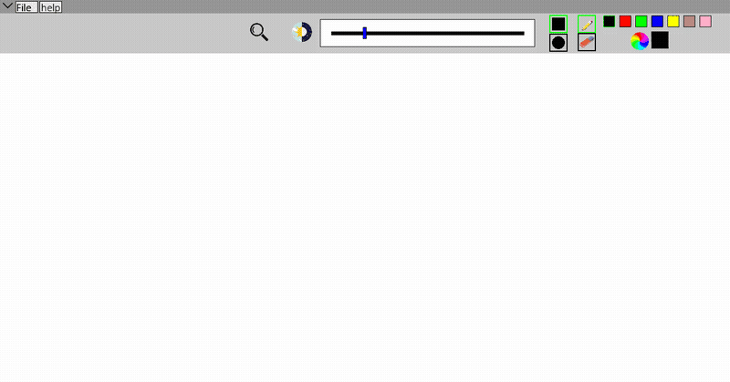

<div align="center">

# My Paint

**Un petit Paint écrit en C.**

  

<sub>Projet à 2 · 2023</sub>

</div>

<br/>

<p align="center"></p>

## En deux mots

Un logiciel de dessin en C avec la CSFML : crayon, gomme, formes et couleurs, avec une vraie barre d'outils et des menus.

## Ce que ça fait

- Crayon et gomme, avec une taille réglable
- Forme du pinceau : carré ou rond
- Palette de couleurs et sélecteur
- Barre de menus avec menus déroulants (fichier, aide)
- Ouverture et sauvegarde d'images

## Sous le capot

Le dessin se fait dans une image CSFML mise à jour pixel par pixel sous le curseur, avec la forme et la taille du pinceau. La barre d'outils est faite de boutons génériques qui ont leur propre état (survol, actif).

## Lancer le projet

```bash
make
./my_paint
```

## L'équipe

<a href="https://github.com/Wilson-Epitech/my_paint/graphs/contributors"></a>

Mathis Brehm, Wilson Bordichon

**Ma part :** J'ai fait la **sélection des outils** (forme, taille et couleur du pinceau), le dessin des formes, les boutons génériques et le redimensionnement automatique de la fenêtre.
